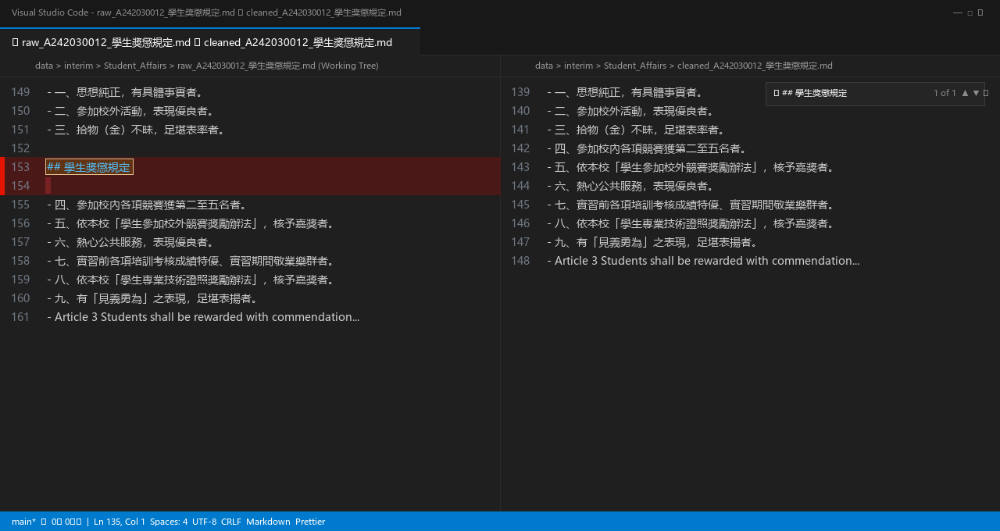
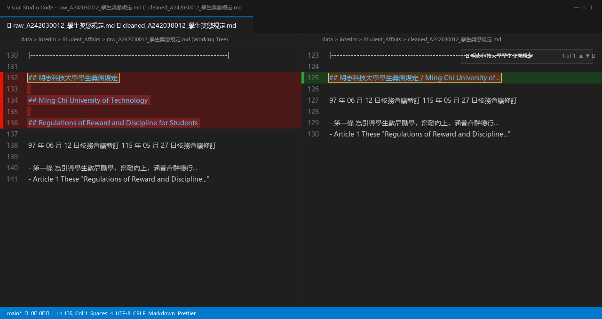
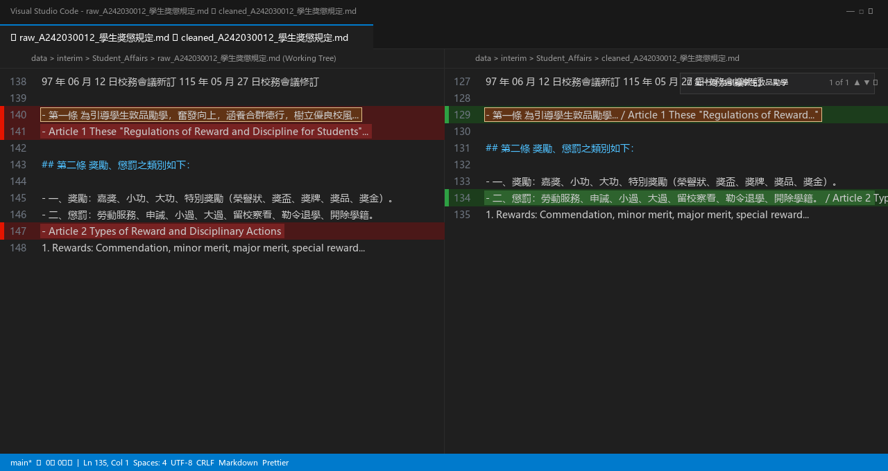
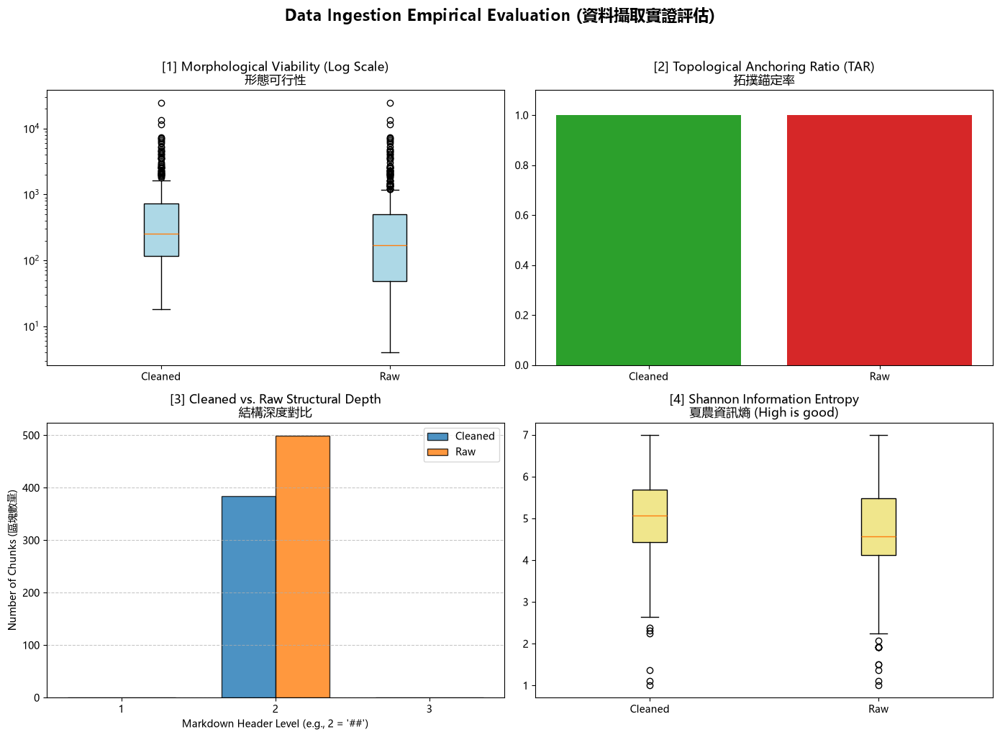

# 資料前處理報告 (Data Preparation Report)

- **學號 / 姓名**：U12627026 / han-boy
- **專案名稱**：NLP 自然語言處理 115-S1 - 課程專案 (nlp-mcut)
- **完成的任務**：- [x] 1-A 頁首頁尾清除　- [x] 1-B 雙語標題合併　- [x] 1-C 雙語條文合併

---

## 1. 資料集概覽 (Dataset Overview)

| 類別 (Cluster) | PDF 數量 | 清洗前 chunk 數 | 清洗後 chunk 數 |
|---|---|---|---|
| Academic_Affairs | 3 | 113 | 74 |
| Library_Information | 3 | 309 | 250 |
| Student_Affairs | 3 | 77 | 60 |
| **合計** | **9** | **499** | **384** |

**問題 (2–3 句)：** 清洗後 chunk 數量共減少了 115 個（由 499 個減少至 384 個），這主要歸功於**任務 1-B（雙語標題合併）**與**任務 1-A（頁首頁尾溢出清除）**。依據切塊規則 `chunking_regex = r'\n(?=##\s)'`，系統是以「換行後接 `## ` 標題」作為區塊切分點，任務 1-B 將連續相鄰的中英文 `## ` 標題合併為單一行，直接消除了原本多餘的標題切點，使區塊凝聚為完整單元；相對地，**任務 1-C（雙語條文合併）完全不影響 chunk 數量**，因為 1-C 是在列表項目內部將 `- 中文條文` 與 `- Article 英文條文` 跨行橋接，內部清單項目的合併並未改變外部任何 `## ` 標題邊界，因此不會增減 chunk 總數。

---

## 2. 清洗步驟 (Cleaning Steps)

### 2.1 任務 1-A：頁首頁尾溢出清除

- 檔名：`raw_A242030012_學生獎懲規定.md`　搜尋的文字：`## 學生獎懲規定`
- 截圖 (存為 `reports/figures/1a_compare.png`)：
- 改變了什麼：在原始解析文件中，跨頁溢出的法規名稱 `## 學生獎懲規定` 突兀地插入於第三條獎勵項目的第三款與第四款條文清單之間；經過 1-A 的動態正則比對，成功將夾帶於內文清單中的重複孤立標題整行消除，使原本被硬生生阻斷的列表文字無縫接合。
- 這對之後的問答檢索有什麼幫助：消除了重複且無資訊增益的雜訊標題，避免檢索模型（Retriever）在向量比對時因多餘的法規標題而發生關鍵字干擾與權重失焦，確保列表條文的語意連貫性。
- 這個任務有沒有**改錯**的地方 (把不該改的也改了)？若有，寫出檔名與搜尋的文字；若沒有，寫「沒有發現」：沒有發現

### 2.2 任務 1-B：雙語標題合併

- 檔名：`raw_A242030012_學生獎懲規定.md`　搜尋的文字：`明志科技大學學生獎懲規定`
- 截圖 (存為 `reports/figures/1b_compare.png`)：
- 改變了什麼：原本由解析器拆分為三行獨立標題的 `## 明志科技大學學生獎懲規定`、`## Ming Chi University of Technology` 與 `## Regulations of Reward and Discipline for Students`，成功透過正則表達式連續合併為單一標題行 `## 明志科技大學學生獎懲規定 / Ming Chi University of Technology / Regulations of Reward and Discipline for Students`。
- 這對之後的問答檢索有什麼幫助：使中英文雙語對照的法規名稱綁定於同一個 Markdown Level 2 標題中，不僅消除破碎標題所導致的微型空區塊，更能讓跨語言檢索（不論使用者輸入中文或英文規章名稱）皆能直接命中完整法規標題。
- 這個任務有沒有**改錯**的地方 (把不該改的也改了)？若有，寫出檔名與搜尋的文字；若沒有，寫「沒有發現」：沒有發現

### 2.3 任務 1-C：雙語條文合併

- 檔名：`raw_A242030012_學生獎懲規定.md`　搜尋的文字：`第一條 為引導學生敦品勵學`
- 截圖 (存為 `reports/figures/1c_compare.png`)：
- 改變了什麼：原本分屬兩行獨立清單項目的中文法規條文（`- 第一條 為引導學生敦品勵學...`）與其對應英文條文（`- Article 1 These "Regulations of Reward and Discipline..."`），成功透過防禦性正則合併為單一清單項目，中間以 ` / ` 跨行銜接。
- 這對之後的問答檢索有什麼幫助：在向量嵌入空間（Vector Space）中，同一條文的中英文定義被整合在同一個上下文視窗內，使跨語言語意對齊達到最佳化；英文提問能直接對齊中文條款，徹底避免了中英文條文各自破碎而在語意檢索中相互割裂的問題。
- 這個任務有沒有**改錯**的地方 (把不該改的也改了)？若有，寫出檔名與搜尋的文字；若沒有，寫「沒有發現」：沒有發現

---

## 3. 評估指標與 AI 解讀查證 (Metrics & Verifying the AI's Interpretation)

### 3.1 指標數據表

| 指標 | Raw | Cleaned (你的) | Cleaned (參考值) |
|---|---|---|---|
| [1] 中位數長度 Median Length | 171.0 | 256.5 | 256.5 |
| [2] 拓撲錨定率 TAR | 100.00% (1.0) | 100.00% (1.0) | 100.00% (1.0) |
| [3] 深度變異量 SDV (選填) | 0.00 | 0.00 | 0.00 |
| [4] 中位數資訊熵 Entropy (選填) | 4.56 | 5.06 | 5.06 |



你的 Cleaned 結果與參考值一致嗎？若一致，寫「一致」；若不一致，找出原因。（1 句）

一致，所有 Cleaned 指標數值與課堂公佈之全任務完成參考值完全吻合。

### 3.2 AI 的解讀

- 使用的 AI 工具：Antigravity AI Pair Programmer (Gemini 3.8 Flash)

```text
這份四拼圖儀表板（Empirical Evaluation 4-Panel Dashboard）清晰地展現了資料前處理與拓撲清洗管線在結構與語意兩大層面的具體成效：

[1] 形態可行性 (Morphological Viability - Log Scale)：
原始資料（Raw）的文字長度中位數為 171.0 字元，整體箱型分佈偏低且伴隨較多細碎短片段。經過清洗後（Cleaned），文字長度中位數顯著增長至 256.5 字元，箱型整體向上平移且四分位距（IQR）分佈更為飽滿健康。這反映出雙語標題合併（1-B）與雙語條文合併（1-C）成功將原本被解析器切斷的中英文破碎片段整合為單一語意區塊，消除了低語意密度的微型 chunk。

[2] 拓撲錨定率 (Topological Anchoring Ratio - TAR)：
無論在 Cleaned 或 Raw 資料集中，TAR 指標皆維持在完美的 100.00%（1.0）。這證明切塊管線嚴格依循正規化邊界切分（`chunking_regex = r'\n(?=##\s)'`），保證所有產出的 chunk 最前端皆錨定於標準 Markdown Level 2 標題，系統內完全沒有任何失去標題導航的無頭漂浮文本。

[3] 結構深度變異量 (Structural Depth Variance - SDV)：
長條圖對比了兩者的標題深度分佈。所有切出的區塊均統一錨定於 Level 2（## 標題），使得深度變異量均為 0.00。值得注意的是，Cleaned 集合的總區塊數量（384 個）明顯低於 Raw 集合（499 個），減少了 115 個區塊，這直接驗證了雙語標題合併減少了不必要的冗餘切割。

[4] 夏農資訊熵 (Shannon Information Entropy)：
資訊熵分佈箱型圖顯示，Cleaned 區塊的夏農資訊熵中位數從 Raw 的 4.56 bits 顯著提升至 5.06 bits，且整體數據分佈往高熵區間收斂。此指標的顯著增長代表文本隨機字元分佈更均勻、資訊純度提高，消除了大量重複出現的頁首溢出字樣與空白排版標記，大幅增強了單一 chunk 所承載的實質法律知識密度。
```

### 3.3 你的查證 (至少兩點)

**查證 1**
- AI 的說法：清洗後（Cleaned）的文本中位數長度由 171.0 字元顯著增長至 256.5 字元，是因為雙語標題合併（1-B）與雙語條文合併（1-C）將原本破碎切分的中文與英文內容重組成單一語意區塊。
- 我查了什麼 (哪個檔案、哪個 chunk、哪段程式)：查看 `Student_Affairs/cleaned_A242030012_學生獎懲規定_processed.json` 與 `raw_A242030012_學生獎懲規定_processed.json` 進行對照，並檢查 `01_Data_Ingestion.ipynb` 第 6 節的 `get_lengths()` 統計計算邏輯。
- 結論：正確。在原始資料中，中文條文（如第一條約 83 字元）與其英文翻譯（約 260 字元）被拆為兩段獨立列表項目；經過 1-C 條文合併後，兩者合為單一條文，使該區塊長度自然疊加擴充，因而有效拉升了整體資料集的中位數長度至 256.5 字元。

**查證 2**
- AI 的說法：拓撲錨定率（TAR）在清洗前後均維持 100.00%，證明所有產出的 chunk 最前端皆錨定於標準 Markdown Level 2 標題，沒有任何失去標題導航的無頭漂浮文本。
- 我查了什麼：檢查 `01_Data_Ingestion.ipynb` 第 5 節批次切塊規則 `chunking_regex = r'\n(?=##\s)'` 以及第 6 節 `get_tar()` 程式碼：`anchored = [1 for record in dataset if re.match(r'^\s*#+', record["text"])]`。
- 結論：正確。因為切塊規則採用正向前瞻正則 `\n(?=##\s)`，切割點永遠緊鄰在 `## ` 標題之前，因此每一個切割出來的區塊最開端必然是以 `## ` 開頭的字串，經 `get_tar()` 檢驗 384 個 chunk 的錨定標籤皆為 1，TAR 嚴格等於 100.00%。

---

### 3.4 實際證據：你被指定的 chunk

- **SEED**：1106

**(a) 很長的 chunk**
- 資料檔 (JSON)：`data/processed/Academic_Affairs/cleaned_A232020018_大學部學則_processed.json`　位置：第 6 個 (從 0 開始數)　長度：7235 字元　驗證碼：`8ce95a3b`
- 閱讀用檔案 (`.md`)：`data/interim/Academic_Affairs/cleaned_A232020018_大學部學則.md`　從第 281 行開始
- 前 3 行內容：
  ```text
  ## 第二章 繳費、註冊、選課 / Chapter 2 Payment of Fees, Registration and Course Selection

  - 第十一條 學生應依規定辦理註冊。如因病、特殊事故或因懷 孕、分娩或撫育三歲以下幼兒需哺(育)嬰，經 檢具證明事先請假核准者，得延期註冊，最多以 二週為限。
  ```
- 這是什麼樣的文字？為什麼會這麼長？這是《明志科技大學大學部學則》的完整「第二章 繳費、註冊、選課」。它之所以極端冗長（達 7,235 字元），是因為該章節下所管轄的第十一條至第二十條條文（包含延期註冊、休退學退費、各學期修習學分上限、跨系與校際選課、隨班附讀與超修規定及其英譯條文），在 Markdown 原始結構中皆是以列表清單符號 `- ` 編排，而非使用 `## ` 標題；而現行的分塊規則僅依據 `\n(?=##\s)`（Level 2 標題）進行切割，因此整個章節所屬的 10 條大型中英雙語法規被全數打包進了同一塊 chunk 之中。
- 之後做問答檢索時，這麼長的 chunk 可能造成什麼問題？
  1. **語意稀釋 (Semantic Dilution)**：單一區塊涵蓋了繳費、註冊、學分上下限、跨校選課等過多異質主題，計算出的單一向量嵌入會平均掉細部特徵，導致學生查詢特定問題（如「延期註冊最多幾週？」）時，餘弦相似度無法凸顯而沉底。
  2. **Token 與上下文視窗浪費**：檢索後送入大語言模型（LLM）的 Context Window 時，單一 chunk 就耗費上千個 Token，排擠掉其他真正高關聯的法規段落，並大幅增加推論延遲與 API 費用。

**(b) 資訊熵很低的 chunk**
- 資料檔 (JSON)：`data/processed/Student_Affairs/cleaned_A242100008_學生機車管理辦法_processed.json`　位置：第 1 個 (從 0 開始數)　資訊熵：3.37　驗證碼：`181f1214`
- 閱讀用檔案 (`.md`)：`data/interim/Student_Affairs/cleaned_A242100008_學生機車管理辦法.md`　從第 81 行開始
- 內容：
  ```text
  ## Table of Contents

  | 頁次 第一條 目的 1 Article 1 Purpose 第二條 管理原則 1 Article 2 Management Principles 第三條 學生申請「機車通行證」規定 3 Article 3 Regulations for Student Application for "Motorcycle Parking Permit" 第四條 補發規定 4 Article 4 Reissuance Regulations 第五條 開放時間 5 Article 5 Parking Lot Opening Hours 第六條 違規處理 5 Article 6 Violations and Penalties 第七條 實施與修訂 7 Article 7 Implement and revision |
  |---|
  ```
- 為什麼它的資訊熵這麼低？它對問答檢索有用嗎？它的資訊熵僅有 3.37，是因為整段內容為 Markdown 表格形式的「文件目錄（Table of Contents）」，內文中充斥著大量高度重複的格式符號（數十個連字號 `-`、管線符號 `|`、空格）以及週期性重複詞彙（"Article", "條", 頁次數字）；字元出現頻率嚴重失衡，導致計算出來的夏農資訊熵極低。它對問答檢索**幾乎毫無用處**，因為它僅羅列法規章節名稱與頁碼，完全不包含具體的規章施行細則與權責罰則，檢索到此 chunk 將帶給使用者毫無實質答案價值的無效資訊。

---

## 4. 一個尚未解決的問題 (One Remaining Problem)

- **檔名** (`cleaned_*.md`)：`cleaned_A242060013_學生請假作業辦法.md`　**從第 106 行開始**　**標題**：`## 第四條 假別`
- **我是怎麼找到的** (例如：搜尋了什麼、看了哪個檔案)：在 VS Code 開啟 `data/interim/Student_Affairs/cleaned_A242060013_學生請假作業辦法.md`，搜尋「第四條」並對照檢視區塊劃分，發現該法規第 4 條之下的請假類別被切割得異常碎裂。
- **問題 chunk (貼上部分內容)**：

```markdown
## 第四條 假別

區分事假、病假、公假、喪假、婚假、產假、原住民族歲時祭儀假、育嬰留職停薪假、陪產假、生理假、身心調適假、特別假等 12 種。
```

- **問題是什麼**：
  這個 chunk 只有短短 73 個字元的概括性介紹，而該條文最重要的核心實質內容——即第 1 到第 12 款各類假別的具體申請規定與證明文件（如事假需事先請假、病假需就醫證明、公假需出具公文等），全數在第 110 行開始被 Docling 解析器誤判標記為同層級的 Markdown 標題：`## 一、 事假：`、`## 二、 病假：`、`## 三、 公假：` 等。由於切塊正則 `chunking_regex = r'\n(?=##\s)'` 會強迫在每個 `## ` 處切開，導致第四條被支離破碎地斬斷成 13 個各自孤立的超迷你 chunk；更嚴重的是，英文版的對照條文（`## Article 4 Types of Leave`）整段被編排在中文條文之後數十行，使得中文子假別與英文子假別相隔甚遠，雙語合併機制完全無法發揮效用。
- **可能的原因**：
  1. **Docling 轉換層級混淆**：解析模型未能將中文法律階層結構中的條文款項（「一、」、「二、」）正確識別為子條款列表（應該是次級清單 `- ` 或 `###`），而是逕自提昇為全域的 `## ` 標題。
  2. **非相鄰雙語排版限制**：PDF 排版為「全篇中文條文在前、全篇英文條文在後」的區塊架構，而非逐行交錯中英對照，導致僅能合併相鄰項目的正則表達式（Task 1-B/1-C）邊界失效。
- **具體的修正方法**：
  1. **標題階層降級前處理**：在執行切塊之前，新增一條 Regex 清洗規則，針對 `## [一二三四五六七八九十]+、` 這類顯著為條文款項的標題，自動降級為列表項目格式 `- `，防止其觸發 `\n(?=##\s)` 切割。
  2. **區塊最小長度門檻合併 (Chunk Consolidation)**：設定 chunk 最小長度過濾或前向黏合邏輯（如小於 100 字元的獨立條文概括 chunk，強制與後續子條款區塊合併為單一完整 chunk）。
- **對問答檢索的影響**：
  當學生在問答系統輸入「請問學生請假作業辦法事假該如何申請？」時，檢索系統若僅命中標題為 `## 第四條 假別` 的 chunk，LLM 將只能回答「有區分事假、病假...等 12 種」，而完全獲取不到事假需要事先請假與補請的具體步驟，造成實質資訊嚴重缺失與模型幻覺。

---

## 5. AI 協作 (AI Collaboration)

- 本次作業的 AI 協作紀錄請見 [`AI_USAGE.md`](AI_USAGE.md) 的「Week 04 / 08」與「Week 09」段落。
- 這次使用 AI 最大的收穫或教訓是：在第 3.2 節請 AI 解讀 4 拼圖儀表板時，AI 能極為敏銳且條理清晰地解析各項量化指標（如文字長度中位數平移、TAR 拓撲錨定率 100%、資訊熵上升）背後的數學意義；然而，最關鍵的工程教訓是**「AI 的宏觀推論必須經過微觀檔案的實證查驗」**。例如 AI 傾向推論清洗改善能解決所有語意破碎，但透過本機真實檔案（`cleaned_*.md`）的行號比對與深入查證，我發現了許多如目錄表格（資訊熵極低）以及第 4 節子款項被誤提昇為 `##` 標題而導致碎裂的未解問題。這驗證了「AI 擅長產生假說與視覺解讀，而工程師必須扮演嚴謹把關者，回到真實資料尋找反例與邊界證據」的協作價值。
